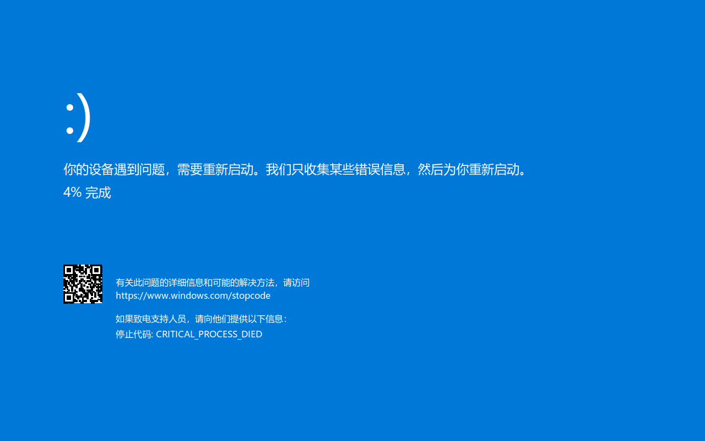
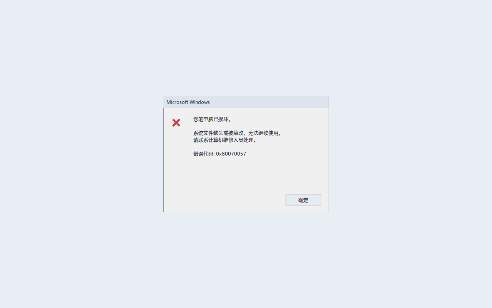

# 儿童电脑使用时长控制

> 一个 exe 搞定：家长用手机浏览器给孩子电脑定使用时长，时间一到屏幕直接“蓝屏”。


不需要服务器、不需要数据库、不需要联网、不需要注册账号。程序跑在孩子电脑上，你的手机连同一个 Wi-Fi 打开网页就能管。

**默认待机不打扰**——程序开机自启，但只有你在手机上点了「开始管控」才开始计时。你自己用电脑时它就是个安静的后台进程。

- **2.2.0**：本地界面改用 **Tkinter + Win32 ctypes**，不再依赖 PyQt5；运行时零第三方 Python 包，单文件体积从约 38 MB 降到约 10–15 MB（以实际打包为准）。
- **2.3.0**：新增可选的**服务化强化保护**，标准用户无法结束保护进程或删除受保护文件（需要管理员安装一次）。
- **2.3.1**：本地控制面板新增「每天允许使用多久」设置。

> 更口语化的分步说明见 [使用说明.md](使用说明.md)；版本变化见 [CHANGELOG.md](CHANGELOG.md)。

---

## 目录

- [特性](#特性)
- [两种运行模式](#两种运行模式)
- [界面预览](#界面预览)
- [系统要求](#系统要求)
- [快速开始：便携模式](#快速开始便携模式)
- [本地控制面板与快捷键](#本地控制面板与快捷键)
- [修改网页监听端口](#修改网页监听端口)
- [强化保护：服务模式（可选）](#强化保护服务模式可选)
- [数据与配置位置](#数据与配置位置)
- [工作原理](#工作原理)
- [锁屏时会发生什么](#锁屏时会发生什么)
- [怎么解锁](#怎么解锁)
- [常见问题](#常见问题)
- [开发与测试](#开发与测试)
- [目录结构](#目录结构)
- [已知边界](#已知边界)
- [安全与隐私](#安全与隐私)
- [更新日志](#更新日志)
- [许可](#许可)

---

## 特性

- **单文件分发（便携模式）**：PyInstaller 打成单个 exe，拷过去双击就能用，无需安装 Python
- **手机网页管理**：内置 HTTP 服务，手机浏览器访问 `http://电脑IP:8080`
- **本地控制面板**：默认按 `Ctrl+Alt+M` 唤出，快捷键可自定义；可改每日额度/端口/快捷键/托盘；打开面板需要管理密码
- **手动启停**：默认待机；发现孩子在玩时点「开始管控」，自己用就点「暂停管控」
- **到点假装故障**：时间用完不做任何提醒，直接切到模拟 Windows 蓝屏；也可选「电脑已损坏」错误弹窗样式
- **锁屏死机模拟**：静音、隐藏鼠标指针、键盘全部冻结、阻止休眠/熄屏，蓝屏进度从 0% 走到 100% 后保持
- **防绕过**：屏蔽 Win 键 / Alt+Tab / Alt+F4 / Ctrl+Shift+Esc；便携模式由 watchdog 拉起，服务模式由 SCM + 守护服务拉起
- **用量防篡改**：SQLite + 注册表双写；服务模式下数据目录有 ACL，并自动备份/恢复
- **家长后门**：手机点「解除锁定」，或在锁定画面上 6 秒内连点鼠标 10 次输入解锁密码
- **可远程留言**：手机上发一句话，电脑端弹出横幅
- **可选隐藏托盘图标**：隐藏后仍可用快捷键唤出面板；若快捷键不可用会自动恢复托盘
- **网页可改监听端口**：无需改配置文件，新端口启动失败会自动回滚
- **强化保护服务（可选）**：Program Files/ProgramData ACL、SYSTEM 会话代理、自动备份恢复、任务管理器策略

---

## 两种运行模式

| | 便携模式 | 服务模式（2.3.0） |
|---|---|---|
| 安装 | 拷 exe 即用 | 管理员运行 `--install` 一次 |
| 程序位置 | 任意目录（建议 `D:\PCTimeControl\`） | `C:\Program Files\PCTimeControlLite\` |
| 数据位置 | `%LOCALAPPDATA%\PCTimeControlLite\` | `C:\ProgramData\PCTimeControlLite\`（ACL 保护） |
| 防结束进程 | 一般（watchdog 拉起，杀掉后仍可删） | 标准用户无法结束 SYSTEM/LocalService 进程 |
| 防删除文件 | 一般 | 普通用户只能读取执行程序；数据目录无权限 |
| 适用场景 | 家长自己也要用、临时试用 | 孩子使用标准用户、家长另有管理员账户 |
| 卸载 | 退出后删 exe + 数据/注册表 | 管理员 `--uninstall`（需要密码） |

> 服务模式**不实现真正的进程隐藏**。用户态无法从任务管理器隐藏进程；那需要内核驱动/rootkit 技术。本方案做到的是“标准用户结束不了、删不掉”，并可选禁用标准用户的任务管理器。

---

## 界面预览

**模拟 Windows 蓝屏（默认）：**

<p align="center"></p>

**“电脑已损坏”错误弹窗（可选）：**

<p align="center"></p>

> 预览图为测试环境渲染，Windows 上使用系统字体，细节会略有差异。

---

## 系统要求

- **受管电脑**：Windows 10 / Windows 11（64 位）
- **开发/打包**：Python 3.10+（推荐 3.12），安装时保留 **Tcl/Tk** 组件；`python -m pip install pyinstaller`
- **服务模式**：安装/卸载需要管理员权限；孩子建议使用**标准用户**账户；家长使用手机网页或管理员账户
- 手机和电脑需要在同一局域网；受管电脑需允许监听端口入站

---

## 快速开始：便携模式

### 1. 打包

```bat
build.bat
```

产物在 `dist\PCTimeControlLite.exe`。

### 2. 放到孩子电脑

把一个 exe 拷过去（建议 `D:\PCTimeControl\`），双击运行。首次运行会先弹出设置窗口；设置完成后右下角托盘出现图标，没有主窗口。

> 首次运行 Windows 会弹防火墙提示，**必须点「允许访问」**，否则手机连不上。

### 3. 首次运行：必须设置密码

第一次启动会弹出一个**不能跳过**的本地设置窗口：

- 管理密码（≥6 位，登录手机页面、打开本地面板用）
- 解锁密码（≥4 位，蓝屏解锁、退出/停止保护用）
- 每天允许使用多久

设置完成前不会启动计时、托盘、快捷键和网页服务。也可以点「退出程序」，但下次启动仍会要求设置。

### 4. 手机登录

手机连同一个 Wi-Fi，打开托盘右键菜单里显示的地址（如 `http://192.168.1.5:8080`），用刚才的管理密码登录。

> 正常首次运行由本地设置窗口完成；网页 `/setup` 仅用于数据库密码被清空等边缘情况。

### 5. 平时怎么用

| 场景 | 操作 |
|---|---|
| 唤出本地控制面板 | 按 `Ctrl+Alt+M`（需管理密码；可在网页/面板中修改） |
| 孩子在玩 | 手机首页点绿色大按钮「▶ 开始管控」 |
| 自己要用电脑 | 点「⏸ 暂停管控」 |
| 现在就不让玩 | 点「🔒 立即锁定」 |
| 时间到被锁 | 手机点「🔓 解除锁定」，或在蓝屏上连点 10 次输密码 |
| 想改每日额度/端口/快捷键/隐藏托盘 | 网页「设置」或本地控制面板 |

---

## 本地控制面板与快捷键

- 默认快捷键：`Ctrl+Alt+M`
- 支持修饰键 `Ctrl` / `Alt` / `Shift` / `Win` + 主键 `A–Z`、`0–9`、`F1–F12`，且至少包含 Ctrl/Alt/Win 之一
- **打开面板会先要求输入管理密码**；面板 3 分钟无操作会自动收起，避免孩子用默认快捷键暂停管控
- 面板「本机设置」还可以修改每日额度（分钟）、监听端口、托盘图标
- 修改入口：网页「设置 → 本机设置」或控制面板
- 快捷键被其他软件占用时，电脑端会保留原快捷键并提示；如果旧值也不可用，会尝试默认值
- **锁屏期间快捷键不生效**，防止孩子直接唤出面板；只能用手机或 10 连点后门解锁
- 托盘图标可在网页或面板中隐藏；隐藏后仍可用快捷键唤出。若热键注册失败且托盘被隐藏，程序会自动恢复托盘，避免本地无法操作

> 管理密码连续输错 5 次会暂停本地面板 1 分钟；网页登录也有失败限流。

---

## 修改网页监听端口

在网页「设置 → 监听端口」输入新端口（1024–65535）并保存：

- 浏览器「不安全端口」（如 6666）会被拒绝
- 已被占用的端口会被拒绝
- 保存后网页服务立即重启，页面会显示新地址
- 新端口启动失败会自动恢复到旧端口
- 也可以在启动时用 `PCTimeControlLite.exe --port 8090`，或改 `config.json`

实际地址以托盘菜单/控制面板显示的为准。

---

## 强化保护：服务模式（可选）

免安装的单 exe 很方便，但孩子杀掉进程后仍可删除文件。如果孩子使用**标准用户**账户、家长另有管理员账户，建议安装为服务。

### 安装（需要管理员一次）

```powershell
# 用管理员 PowerShell 运行（会弹 UAC）
& "D:\PCTimeControl\PCTimeControlLite.exe" --install
```

安装器会：

- 把程序复制到 `C:\Program Files\PCTimeControlLite\`
- 把现有便携数据迁移到 `C:\ProgramData\PCTimeControlLite\`（已有数据库则保留）
- 设置 ACL：程序目录普通用户只能读取/执行（不能修改/删除）；数据目录普通用户无权限
- 创建 `PCTimeGuard`（LocalSystem 守护）和 `PCTimeWeb`（LocalService 网页/状态）两个服务
- 在非管理员用户会话中启动 **SYSTEM 代理**：托盘、热键、本地面板、假蓝屏、静音都由它执行
- 首次安装时由管理员现场设置管理/解锁密码（若数据库还没有密码），避免孩子抢先设置
- 添加私有/域网络的入站防火墙规则
- 守护服务定期备份数据库/设置到受保护目录和 `HKLM`，数据库丢失/损坏时自动恢复；并周期性修复 ACL

孩子登录标准用户后代理自动启动；家长的**管理员会话不会锁屏**，继续用手机管理。如果家长和孩子共用标准账户，该会话也会受保护，家长用手机「暂停管控」。

### 服务组成

```
PCTimeGuard (LocalSystem 服务)
  ├─ 文件 ACL / 防删除句柄 / 备份恢复
  ├─ 任务管理器策略
  ├─ 启动并看护 PCTimeAgent（SYSTEM，用户会话）
  └─ 看护 PCTimeWeb（LocalService 服务）

PCTimeWeb (LocalService 服务)
  └─ 状态机 + HTTP 8080（手机网页；不以 SYSTEM 暴露网络）

PCTimeAgent (SYSTEM，仅在非管理员会话)
  └─ 托盘 / 热键 / 本地面板 / 锁屏 / 静音 / 键盘钩子 / keep-awake
```

### 任务管理器策略

网页「设置 → 本机设置」有「对标准用户禁用任务管理器」开关，**默认开启**。守护服务会对非管理员会话写入并持续恢复 `DisableTaskMgr=1`。

这不是真正的“进程隐藏”，而是阻止孩子使用任务管理器。管理员会话不受影响；共用标准账户的家长可在网页关闭。进程本身在任务管理器/服务列表中仍然可见，但标准用户**无法结束** SYSTEM/LocalService 进程。

> 本地面板里的「停止保护服务」是**临时停止**，重启电脑后服务会自动恢复；要彻底移除请用下面的 `--uninstall`。

### 停止与卸载

```powershell
# 临时停止（重启后自动恢复）：本地面板 → 停止保护服务
# 或管理员：
sc stop PCTimeGuard
sc stop PCTimeWeb

# 彻底卸载（需要管理员 + 管理/解锁密码）
& "C:\Program Files\PCTimeControlLite\PCTimeControlLite.exe" --uninstall
```

卸载会停止/删除服务、结束代理、清理任务管理器策略/防火墙/ACL/注册表和受保护数据。忘记密码时，管理员可用：

```powershell
& "C:\Program Files\PCTimeControlLite\PCTimeControlLite.exe" --uninstall --force
```

### 服务模式的边界

- **真正的进程隐藏不做**：那需要内核驱动/rootkit 技术，容易被杀软判定为恶意软件；本方案只做到“标准用户结束不了、删不掉”。
- 服务模式的托盘图标由 SYSTEM 代理创建，个别系统上托盘菜单可能受 UIPI 限制；**快捷键（默认 `Ctrl+Alt+M`）和手机网页始终可用**。
- 管理员账户、安全模式、物理接触（PE/另一块硬盘）仍可绕过；任何用户态方案都无法对抗管理员。
- 任务管理器策略是用户策略，孩子若懂注册表可能尝试修改；守护服务会持续恢复。
- Web 服务以 **LocalService** 运行，不以 SYSTEM 暴露网络；锁屏/静音代理才是 SYSTEM。
- 便携模式仍然是默认的免安装模式；服务模式需要先打包成 exe 并安装。

---

## 数据与配置位置

| 内容 | 便携模式 | 服务模式 |
|---|---|---|
| 数据库 | `%LOCALAPPDATA%\PCTimeControlLite\data.db` | `C:\ProgramData\PCTimeControlLite\data.db` |
| 配置 | `%LOCALAPPDATA%\PCTimeControlLite\config.json` | `C:\ProgramData\PCTimeControlLite\config.json` |
| 日志 | `%LOCALAPPDATA%\PCTimeControlLite\client.log` | `C:\ProgramData\PCTimeControlLite\client.log` |
| 音频状态 | `...\audio.state` | `...\audio.state` |
| 备份 | — | `...\backup\` + `HKLM\Software\PCTimeControlLite` |
| 用量冗余 | `HKCU\Software\PCTimeControlLite` | 受保护 DB + HKLM 备份 |

- 便携模式删除 `%LOCALAPPDATA%\PCTimeControlLite` 和 `HKCU\Software\PCTimeControlLite` 可回到首次设置状态。
- 服务模式的数据目录有 ACL，普通用户无法直接删除；请使用 `--uninstall` 清理。
- 服务模式的备份 JSON 不含密码哈希；数据库备份在受 ACL 保护的目录中。

---

## 工作原理

### 便携模式

```
┌─────────────────── 孩子的电脑 ────────────────────┐
│                                                    │
│   Tkinter 托盘程序（无主窗口，无第三方 GUI 依赖）   │
│     ├── 计时器：读 SQLite 累计当日用量               │
│     ├── 内置 HTTP 服务 0.0.0.0:8080 ──┐            │
│     ├── 锁屏画面（假蓝屏 / 假弹窗）    │            │
│     ├── 静音 + 键盘钩子（吞掉全部按键）│            │
│     ├── 全局热键 → 本地控制面板        │            │
│     └── watchdog（被杀后拉起）         │            │
└───────────────────────────────────────┼────────────┘
                                        │ 同一个 Wi-Fi
                              ┌─────────┴─────────┐
                              │   家长手机浏览器   │
                              │  设置 / 启停 / 解锁 │
                              └───────────────────┘
```

### 服务模式

```
家长手机 ── HTTP ── PCTimeWeb (LocalService) ── SQLite (ProgramData)
                              │
                              ▼
                    PCTimeGuard (LocalSystem)
                    ├─ ACL / 防删除句柄 / 备份
                    ├─ 任务管理器策略
                    └─ 启动/看护 PCTimeAgent (SYSTEM，用户会话)
                              └─ 锁屏 / 静音 / 键盘钩子 / 托盘 / 热键
```

- Web 线程只读写 SQLite，不碰 Tk 对象；主线程每 100 ms 轮询托盘/热键事件队列，每秒同步状态
- 密码用 PBKDF2-SHA256 加盐存储；Web 会话 token 存内存；表单带同源校验；登录失败限流
- 便携模式用量同时写 SQLite 和注册表 `HKCU\Software\PCTimeControlLite`，两边取最大值
- 服务模式用量写入受 ACL 保护的 DB，并定期备份到受保护目录/HKLM
- 锁屏时通过 Windows Core Audio 静音默认播放设备，解锁后恢复；进程被强杀遗留的静音会在下次启动时恢复
- 端口修改通过数据库指令队列交给状态机执行，Web 线程不直接操作 HTTP 服务实例

---

## 锁屏时会发生什么

- 所有显示器全屏蓝屏，鼠标指针隐藏
- 键盘钩子吞掉全部按键（包括 Win、Alt+Tab、Alt+F4、Ctrl+Shift+Esc）
- 系统默认播放设备静音，并阻止系统休眠/关闭显示器
- 进度从 0% 走到 100%（约 25–45 秒），到 100% 后保持画面，不真的重启
- **不会出现「今天时间已到」等提示**，看起来就是电脑坏了
- 家长仍可主动从手机发一句话；那是主动消息，不是自动提醒

> `Ctrl+Alt+Del` 是 Windows 安全序列，用户态程序无法拦截。但用量按天累计，注销/重启回来照样锁。

---

## 怎么解锁

**方式一（推荐）**：手机打开管理页 → 点「🔓 解除锁定」。电脑立刻恢复，今天重新计时，声音恢复。

**方式二（手机不在身边）**：在蓝屏画面上快速连点鼠标 10 次（6 秒内），弹出「系统恢复」框，输入解锁密码。

蓝屏样式和「电脑已损坏」弹窗样式都支持这 10 下连点。密码框显示期间只放行普通字符，Win / Alt / Ctrl 组合键仍被拦截。

---

## 常见问题

**Q：手机打不开网页 / 一直转圈**

1. 确认手机和电脑连的是**同一个 Wi-Fi**（不是手机流量）
2. 看托盘菜单或控制面板里的地址对不对（IP 可能变了）
3. 防火墙没放行：控制面板 → Windows Defender 防火墙 → 允许应用通过防火墙 → 找到 `Python` / `PCTimeControlLite` → 勾上「专用网络」
4. 有些路由器开了「AP 隔离」，设备之间不能互访，去路由器设置里关掉
5. 如果改过端口，确认手机访问的是新端口
6. 服务模式安装器只添加**专用/域网络**规则；如果当前 Wi-Fi 被 Windows 标为“公用”，请改为“专用”或手动放行

**Q：没有设置过密码，为什么托盘/控制面板/网页要求输入密码？**

首次设置窗口只在 `admin_hash` 和 `unlock_hash` 都为空时出现；程序读到已有 `data.db` 时会直接使用旧密码。最常见原因：

- 之前跑过回归测试：测试数据使用 `admin123` / `888888`（仅测试期间）
- 之前运行过旧版本或安装过服务，数据库里有旧密码
- 旧实例/测试客户端还在运行，新 exe 因单实例直接退出，你点的是旧实例的托盘图标

先尝试 `admin123`。如果确认是旧数据，重置便携模式：

```powershell
# 停掉旧实例和 watchdog
Get-CimInstance Win32_Process |
  Where-Object {
    $_.Name -eq 'PCTimeControlLite.exe' -or
    ($_.CommandLine -like '*PC_UES_TIME_CONTROL_LITE*main.py*')
  } |
  ForEach-Object { Stop-Process -Id $_.ProcessId -Force -ErrorAction SilentlyContinue }

# 删除数据、注册表和测试开关
Remove-Item "$env:LOCALAPPDATA\PCTimeControlLite" -Recurse -Force -ErrorAction SilentlyContinue
Remove-Item "HKCU:\Software\PCTimeControlLite" -Recurse -Force -ErrorAction SilentlyContinue
Remove-Item Env:PCTL_SKIP_LOCAL_SETUP -ErrorAction SilentlyContinue
Remove-ItemProperty "HKCU:\Software\Microsoft\Windows\CurrentVersion\Run" `
  -Name PCTimeControlLite -ErrorAction SilentlyContinue
```

重新运行 exe，就会回到首次设置。服务模式请用 `--uninstall --force` 后重新 `--install`。

**Q：电脑 IP 老是变怎么办**

在路由器管理界面里给孩子电脑绑定固定 IP（DHCP 静态分配），或在托盘/控制面板里看当前地址。

**Q：孩子把程序关了 / 删了怎么办**

- 便携模式：有 watchdog，3 秒内自动拉起；但杀掉 watchdog 后仍可删除文件。
- 服务模式（推荐，孩子为标准用户）：SYSTEM 代理和 LocalService 服务无法被标准用户结束；Program Files/ProgramData 有 ACL，普通用户无法删除。管理员账户、安全模式或物理接触仍可绕过。

**Q：孩子重启电脑，时间会清零吗**

不会。用量存在数据库里；便携模式还同时写注册表。服务模式的数据在受 ACL 保护的 ProgramData，并有备份。

**Q：忘记管理密码了**

- 便携模式：删除 `%LOCALAPPDATA%\PCTimeControlLite\data.db` 和注册表 `HKCU\Software\PCTimeControlLite`，重新打开程序会回到首次设置状态（当天用量也会清掉）。
- 服务模式：管理员运行 `PCTimeControlLite.exe --uninstall --force`，再重新 `--install`。

**Q：忘记解锁密码了**

用管理密码登录网页，在「设置 → 修改密码」里重设；如果两个都忘了，按上面的重置步骤。

**Q：隐藏托盘图标后，怎么恢复？**

按快捷键打开控制面板（需管理密码），取消勾选「隐藏系统托盘图标」；或者用手机网页「设置 → 本机设置」取消。若快捷键也失效，程序会自动恢复托盘。

**Q：服务模式下托盘菜单点不动 / 没反应？**

SYSTEM 代理创建的高完整性托盘可能受 Windows UIPI 限制。请使用快捷键 `Ctrl+Alt+M`（输入管理密码）或手机网页；这是已知边界。

**Q：锁屏后电脑一直静音？**

正常解锁（手机或后门）会恢复锁屏前的静音状态。如果程序被强杀，下次启动会自动恢复之前保存的状态。

**Q：怎么彻底卸载**

- 便携模式：托盘「退出（需要解锁密码）」→ 删除 exe 所在目录 → 删除 `%LOCALAPPDATA%\PCTimeControlLite` → 删除 `HKCU\Software\Microsoft\Windows\CurrentVersion\Run\PCTimeControlLite` 和 `HKCU\Software\PCTimeControlLite`。
- 服务模式：管理员运行 `& "C:\Program Files\PCTimeControlLite\PCTimeControlLite.exe" --uninstall`，按提示输入管理/解锁密码；忘记密码用 `--force`。

**Q：为什么端口是 8080？我用 6666 为什么打不开**

浏览器内置「不安全端口」黑名单（包含 `6665–6669`、`10080`、`6000`、`5060` 等），访问这些端口会直接报 `ERR_UNSAFE_PORT`。本程序默认 8080；被占用会自动往后找。改端口时也会拒绝黑名单端口。

**Q：服务模式会不会上传数据？**

不会。没有云服务、没有账号、没有遥测；数据库、日志和备份都只在本机，手机网页仅在局域网访问。

---

## 开发与测试

Windows 上从源码运行（不需要 PyQt5）：

```bat
python main.py
```

需要 Python 3.10+ 且带 Tcl/Tk。可选使用 uv：

```bat
uv sync
uv run python main.py
```

打包：

```bat
build.bat
```

回归测试（会清空数据、启动真实客户端，并真实触发锁屏；测试环境会禁用静音）：

```powershell
powershell -ExecutionPolicy Bypass -File tests\run_all.ps1
```

`run_all.ps1` 会清空数据库和注册表用量，并设置：

- `PCTL_DISABLE_AUDIO=1`：不真正静音
- `PCTL_SKIP_LOCAL_SETUP=1`：跳过本地首次设置，改由网页 `/setup` 完成
- `PCTL_SKIP_AUTOSTART=1`：不写开机自启

依次运行：

| 测试 | 覆盖 |
|---|---|
| `_test_web_lite.py` | 首次设置、登录、改设置、启停、锁定/解锁、CSRF、路径穿越、本机设置/端口校验 |
| `_test_e2e_lite.py` | 时间耗尽直接蓝屏（无任何提醒）、手机解锁恢复、暂停不锁 |
| `_test_units_lite.py` | 快捷键解析、端口校验、连点计数、静音状态机、数据库迁移、登录限流、指令分流 |
| `_test_backdoor.py` | 连点 9 次不触发、第 10 次触发、超时不累计（纯逻辑） |
| `_test_ui_lite.py` | Tkinter 进度、连点绑定、首次设置提交、后门密码框、控制面板刷新 |
| `_test_service_units.py` | 服务数据目录、备份恢复、JSON 重建、ACL 参数、服务启动命令、任务管理器策略 |

单独跑某个测试：先启动客户端（测试前设置上述环境变量），再执行对应脚本。

测试结束后 `run_all.ps1` 会停止客户端、把日志保存到 `tests\last_run.log`，并删除测试数据/注册表，**不会把测试密码 `admin123` 留在你的机器上**。

> 服务模式的 SCM、SYSTEM 会话代理、ACL 和安装/卸载需要在 Windows 上手工验收；`run_all.ps1` 覆盖的是便携模式和纯逻辑。

可选代码检查：

```bat
uvx ruff check --select F821,F401,F811,F841 .
```

---

## 目录结构

```
├── main.py                  程序入口：Tk 主循环、便携模式、服务模式分派
├── autostart.py             开机自启（便携模式写 HKCU Run 键）
├── core/
│   ├── config.py            路径、版本、端口（含浏览器不安全端口黑名单）
│   ├── store.py             SQLite + 注册表双写存储
│   ├── hotkey.py            快捷键字符串解析/规范化
│   ├── backdoor.py          锁屏连点计数
│   ├── audio.py             Core Audio 静音/恢复
│   ├── netinfo.py           局域网 IP 探测
│   └── guard.py             键盘钩子（锁屏吞掉全部按键）
├── ui/
│   ├── win32.py             托盘、热键、互斥体、多显示器、DPI
│   ├── lock_screen.py       Tkinter 假蓝屏 / 假弹窗 / 解锁密码框
│   ├── toast.py             家长留言横幅
│   └── panel.py             本地控制面板 + 首次设置窗口
├── web/
│   ├── server.py            内置 HTTP 服务与路由
│   ├── pages.py             手机页面渲染
│   └── static/app.css       样式
├── service/                 强化保护服务模式
│   ├── guard.py             LocalSystem 守护：ACL/备份/会话代理
│   ├── web_core.py          LocalService：状态机 + Web
│   ├── agent.py             用户会话 SYSTEM 代理：锁屏/托盘/热键
│   ├── install.py           安装/卸载
│   ├── wts.py / scm.py      Windows 会话/服务控制
│   └── acl.py / backup.py / policy.py / fileguard.py
├── tests/                   回归测试
├── docs/                    设计文档与界面预览
├── app.ico                  图标（含 16~256 七个尺寸）
├── ICO/logo.png             图标设计原稿
├── version_info.txt         exe 属性里的版本信息
├── build.bat                一键打包
├── pyproject.toml           uv 开发环境（无运行时依赖）
├── uv.lock
├── CHANGELOG.md
├── CLAUDE.md                项目开发说明
└── README.md
```

---

## 已知边界

- `Ctrl+Alt+Del` 拦不住；这是 Windows 安全序列。
- 便携模式防不住懂技术的孩子；服务模式可以挡住标准用户，但管理员、安全模式和物理接触仍能绕过。
- 没有内核驱动/rootkit，所以不会真正隐藏进程；任务管理器策略只是提高门槛。
- 服务模式的 SYSTEM 托盘在高完整性/低完整性隔离下可能无法点击；快捷键和手机网页始终可用。
- 手机和电脑必须在同一局域网；公司 Wi-Fi 若开启客户端隔离，请改用手机热点。
- 受管电脑需允许监听端口入站（部分安全软件会拦）。
- 静音只作用于 Windows 默认播放设备；切换输出设备需要先解锁。
- 锁屏期间全局快捷键被禁用，这是有意设计。
- 回归测试需要 Windows 桌面环境；服务模式的真实 SCM/ACL/SYSTEM 代理行为需在 Windows 上手工验收。

---

## 安全与隐私

- 所有数据保存在本机；没有云服务、账号或遥测。
- 管理/解锁密码使用 PBKDF2-SHA256 加盐存储；Web 会话 token 只在内存中；登录失败有限流。
- 服务模式需要管理员安装；请只在您拥有管理员权限的家庭电脑上使用。
- 本项目用于家庭使用时长管理，不用于未经授权的设备，也不用于绕过他人的安全设置。
- 服务模式不会实现内核级进程隐藏或 rootkit 行为。

---

## 更新日志

见 [CHANGELOG.md](CHANGELOG.md)。

---

## 许可

[MIT](LICENSE)

可自由使用、修改、分发，包括商业用途 —— 惟须在所有副本或重要部分中保留上述版权声明和本许可声明。

## 作者

野怼怼 · https://www.bd7iwd.com

本项目所有源文件均在文件头保留作者署名。
